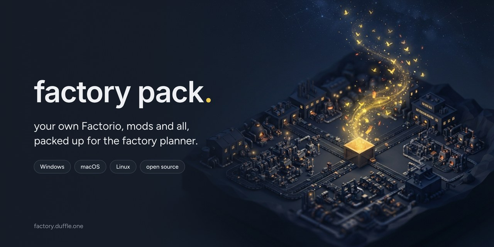
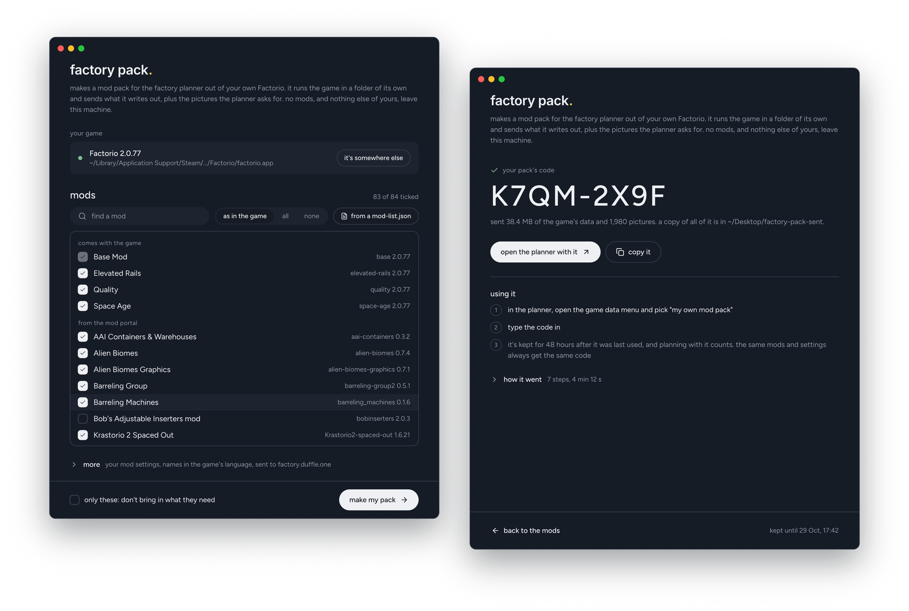

<p align="center">
  
</p>

# Factory Pack

Plan your factory with your own mods. Factory Pack is a small, free, open-source app that reads your copy of Factorio, mods and settings and all, and turns it into a pack for the [factory planner](https://factory.duffle.one). It gives you a code; type it into the planner and you're planning with exactly what's in your game.

## Download

| Your computer | Get this | Then |
| --- | --- | --- |
| **Windows** 10 or 11 | [FactoryPack-Windows.exe](https://github.com/DuffleOne/factory-pack/releases/latest/download/FactoryPack-Windows.exe) | Run it. The app isn't signed, so the first time Windows says it protected your PC: click **More info**, then **Run anyway**. |
| **macOS** 11 or later, Apple silicon or Intel | [FactoryPack-macOS.zip](https://github.com/DuffleOne/factory-pack/releases/latest/download/FactoryPack-macOS.zip) | Unzip it and open **Factory Pack**. It's signed and notarised by Apple, so it opens like any other app. |
| **Linux**, Steam Deck, Bazzite | [FactoryPack-Linux.AppImage](https://github.com/DuffleOne/factory-pack/releases/latest/download/FactoryPack-Linux.AppImage) | Allow it to run as a program (right-click it, **Properties**, **Permissions**), then open it. Everything it needs is inside it. |

There's a command-line version for each as well, on [the latest release](https://github.com/DuffleOne/factory-pack/releases/latest), and every release lists a checksum for each file in `SHA256SUMS`.

<p align="center">
  
</p>

## How it works

1. **Open Factory Pack.** It finds Factorio by itself, Steam libraries included, and ticks the mods your game has switched on.
2. **Press "make my pack".** Untick anything you'd rather leave out first. Your game runs three times in the background to write out its data, which takes a few minutes with a lot of mods.
3. **Use the code.** You get a code like `K7QM-2X9F`. In the planner, open the game data menu at the top, pick **my own mod pack** and type it in, or press **open the planner with it** and it's done for you.

A pack lasts 48 hours after it was last used, and planning with it counts as using it. Run Factory Pack again with the same mods and settings and the same code comes back.

## Is it safe?

It never uploads your mods, your saves or any of your own files. What it sends is the data your game writes about itself when asked, and the pictures the planner needs to draw your items and buildings.

**What it sends**

- `data-raw-dump.json`: every item, recipe and building in your game, with your mods and their settings applied. Factorio writes it with `--dump-data`.
- What everything is called, from `--dump-prototype-locale`.
- Where pipes join each crafting machine, written by a small scenario, [`fluidboxes.lua`](internal/factorio/fluidboxes.lua), that's easy to read.
- The name and version of each mod, the game's version, and what you called the pack.
- The pictures the planner asks for, by name.

**What it never touches**

Your saves, your settings, and `player-data.json`, which holds your Factorio login. Pictures are the only thing read from Factorio's files, and the app sends one only if it's a PNG, named the way the game names its pictures, inside the game's own folder or one of the mods you picked. Anything else is refused before the file is even opened, whatever the planner asks for, so nobody can use the app to ask for anything else on your computer.

**What it changes**

Nothing. The game runs in a folder of its own, made fresh and deleted afterwards. Your mods, mod list and settings are never written to. Your mod settings are copied into that folder so the game loads them, and they're never sent.

**See for yourself**

- Under **more**, "keep a copy of what's sent in" keeps everything that goes up, so you can look through it.
- On the command line, `factory-pack -no-send -keep some-folder` makes everything and sends nothing.
- Every release is built by GitHub from the code here, by [these workflows](.github/workflows). The Windows and Linux files come with a build attestation, so `gh attestation verify FactoryPack-Windows.exe --repo DuffleOne/factory-pack` proves a download was built from this repository. The Mac ones are built the same way, then signed with my Apple Developer ID and notarised by Apple, which checks them for malware before macOS will open them.

The planner, for its part, treats everything it receives as if a stranger sent it: everything is size-checked, every number in a pack is checked against what a real game could have, and pictures are decoded and kept only as pixels.

## Questions

**Does it need my Factorio account?** No. It never reads your login, and the game it runs doesn't sign in to anything.

**Why does Windows warn me about it?** Signing a Windows app costs money every year, and this one is free. The warning only means it isn't signed. The source is all here, and each release has checksums and build attestations if you'd like to check it.

**It can't find my game.** Press **it's somewhere else** and point it at the game: `factorio.exe` on Windows, `factorio.app` on a Mac, `bin/x64/factorio` on Linux. If you unpacked Factorio from a zip rather than installing it, point it at that copy.

**I'm on a Steam Deck.** Switch to desktop mode (hold the power button, **Switch to Desktop**), download the AppImage in a browser, and open it from the file manager.

**The AppImage won't start.** AppImages need FUSE, which Steam Decks, Bazzite and most desktops already have. Where it's missing, run it from a terminal as `./FactoryPack-Linux.AppImage --appimage-extract-and-run`.

**Can I make a pack of a multiplayer server's mods?** Yes. Ask whoever runs the server for its `mod-list.json` and `mod-settings.dat`. Press **from a mod-list.json** to tick the mods it uses, and under **more** set the mod settings to that file. You'll need those mods in your own mods folder, which you will if you play there.

**Something went wrong.** [Open an issue](https://github.com/DuffleOne/factory-pack/issues/new) with what it said. The command-line version prints the game's own last words when the game is what failed.

## On the command line

Each release has `factory-pack` for Windows, macOS and Linux. It does everything the app does.

```
factory-pack -list
factory-pack
factory-pack -mods Krastorio2-spaced-out -settings defaults -name "K2 Spaced Out"
factory-pack -mod-list server/mod-list.json -settings server/mod-settings.dat -name "our server"
```

`factory-pack -h` lists every option. `-save` remembers the ones you give for next time, in the same settings file the app uses (`factory-pack/config.json` in your system's settings folder). If the game isn't found, `-game` says where it is, or `FACTORIO_PATH` does.

## Building it yourself

You'll need [Go](https://go.dev/dl/) 1.26 or later.

```
go build ./cmd/factory-pack          # the command line, for anywhere
cd app
go build -tags production .          # the app, on macOS or Windows
go build -tags gtk3,production .     # the app, on Linux, with libgtk-3-dev and libwebkit2gtk-4.1-dev
```

`go test ./...` at the top runs the tests. A tag like `v1.2.3` has GitHub build every download and draft a release; `scripts/sign-mac.sh v1.2.3`, on a Mac with a Developer ID certificate, then signs and notarises the Mac ones before it's published.

<details>
<summary>How it fits together</summary>

- `internal/factorio` finds the game, lists its mods and runs it in a scratch folder.
- `internal/pack` makes the export, reads pictures under the rules above, and talks to the planner.
- `cmd/factory-pack` is the command line, with no dependencies past Go's own.
- `app` is the window: a [Wails](https://wails.io) app in a module of its own, with a page of plain HTML and JavaScript and no build step.

The planner takes a pack in three steps. `POST /api/packs` takes the export, a gzipped tar, and answers with the pack's code, a token and the pictures it wants. `POST /api/packs/{code}/pictures` takes those in batches, with the token. `POST /api/packs/{code}/build` starts the build, and `GET /api/packs/{code}` says how it's going.

</details>

## Licence

MIT, see [LICENSE](LICENSE). The app carries the [Figtree](https://github.com/erikdkennedy/figtree) and [Inter](https://rsms.me/inter/) fonts under the SIL Open Font License, and icons from [Lucide](https://lucide.dev) under the ISC licence. Factorio is a game by Wube Software; this isn't made by or connected with them.
